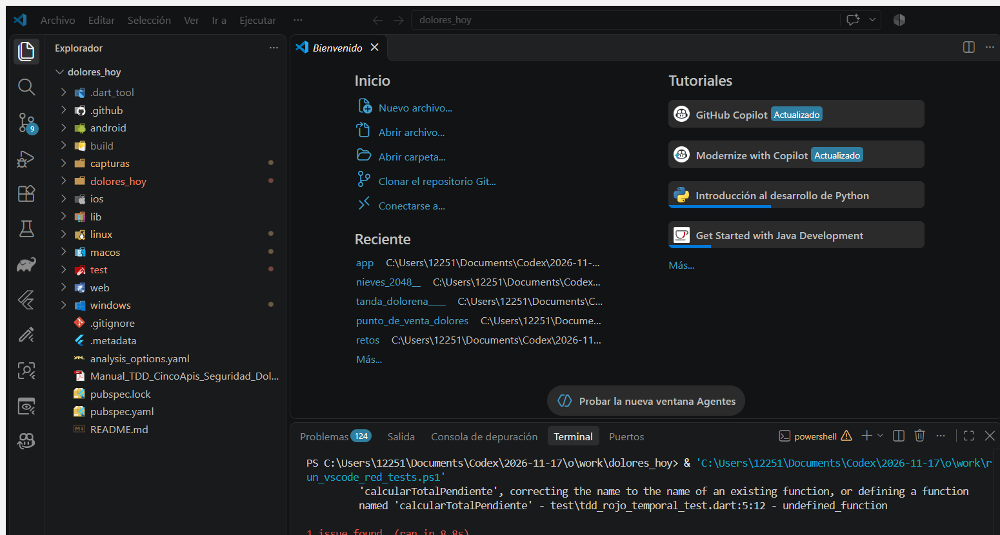

# Dolores Hoy

Proyecto hecho en Flutter para mostrar información útil de Dolores Hidalgo.

La aplicación consulta cinco servicios:

- Clima.
- Tipo de cambio.
- Días festivos.
- Información de Wikipedia.
- Imagen del día de la NASA.

## Captura de la aplicación


## Cómo ejecutarlo

```bash
flutter pub get
flutter run
```

## Pruebas

Usé el ciclo rojo y verde. Primero dejé una función sin hacer para comprobar que apareciera el error y después ejecuté el proyecto terminado.

```bash
flutter test
```

| Prueba con error | Prueba terminada |
|---|---|
|  |  |

Resultado final: **1 prueba aprobada**.
