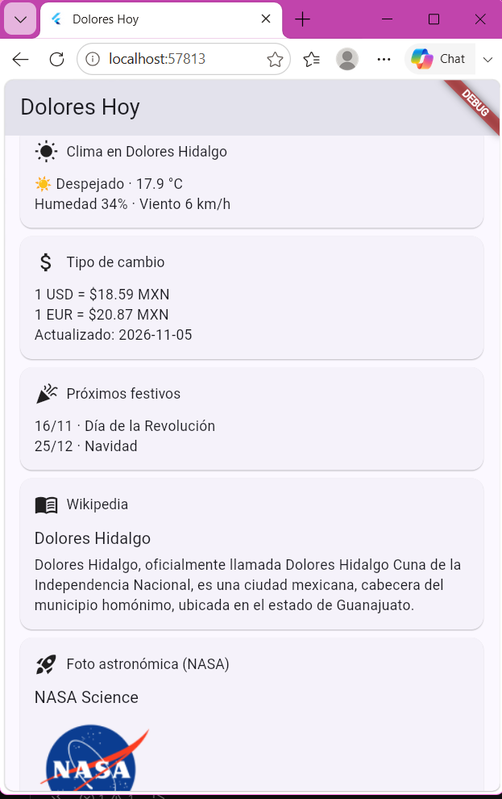
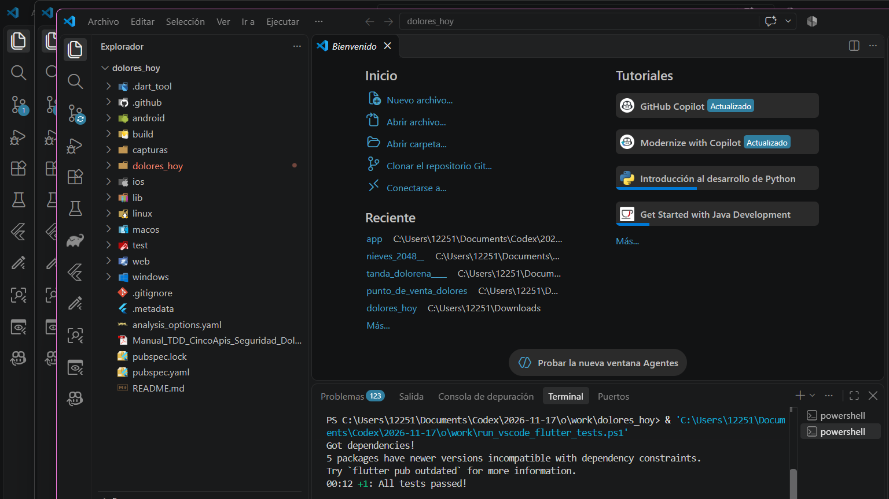

# Dolores Hoy

Dolores Hoy es una aplicación de Flutter que muestra información de Dolores Hidalgo.

Consulta clima, tipo de cambio, días festivos, Wikipedia y la imagen del día de la NASA.

## Captura de la aplicación



## Cómo ejecutarlo

```bash
flutter pub get
flutter run
```

Para ejecutar la prueba:

```bash
flutter test
```

## Todas las pruebas

Se ejecutó la prueba disponible en el repositorio:

1. La prueba básica de interfaz comprueba que el contador cambia correctamente.

Resultado final: **1 prueba aprobada**.

## Capturas reales de la prueba

### Fase roja


### Fase verde


