# 🌤️ Dolores Hoy

Tablero en **Flutter** que consume **5 APIs gratuitas** con buenas prácticas de seguridad, desarrollado con **TDD** (Desarrollo Guiado por Pruebas).

> Clima · Tipo de cambio · Festivos · Wikipedia · NASA
>
> Desarrollo Móvil Integral · UTNG · Prof. Anastacio Rodríguez García

<p align="center">
  
</p>

---

## 📖 Descripción

Imagina el tablero de información de la plaza de Dolores Hidalgo: te dice qué clima hace, a cuánto está el dólar, cuándo es el próximo día festivo, algo de historia del lugar y la foto astronómica del día. Cinco datos, cinco fuentes distintas, todas servicios gratuitos de internet (APIs).

## 🌐 Las 5 APIs

| # | API | Qué muestra | Clave |
|:-:|-----|-------------|:-----:|
| 1 | [Open-Meteo](https://open-meteo.com) | Clima actual de Dolores Hidalgo | No |
| 2 | [Frankfurter](https://frankfurter.dev) | Tipo de cambio MXN / USD / EUR | No |
| 3 | [Nager.Date](https://date.nager.at) | Próximos días festivos de México | No |
| 4 | [Wikipedia (es)](https://es.wikipedia.org) | Resumen de un tema del usuario | No |
| 5 | [NASA APOD](https://api.nasa.gov) | Foto astronómica del día | **Sí** |

## ✨ Características

- 🔌 Un solo cliente HTTP reutilizable (`ClienteSeguro`) para las 5 APIs.
- 🧪 Pruebas con `MockClient`: sin internet y sin gastar cupo.
- 🔒 **Seguridad aplicada:** HTTPS obligatorio, claves fuera del código, validación de entradas y salidas, límites de tamaño y de tiempo, errores que no filtran información y logs sin secretos.
- 🛟 **Resiliencia:** si una API se cae, las otras cuatro siguen funcionando.
- ⚡ Las 5 peticiones salen al mismo tiempo (`Future.wait`).

## 🧰 Tecnologías

- [Flutter](https://flutter.dev) / Dart (SDK `>=3.0.0 <4.0.0`)
- [`http`](https://pub.dev/packages/http) (única dependencia)

## 🗂️ Estructura del proyecto

```
dolores_hoy/
├── lib/
│   ├── dominio/
│   │   ├── excepciones.dart       # errores con mensajes seguros
│   │   └── modelos.dart           # Clima, TipoCambio, Festivo, ResumenWiki, FotoAstronomica
│   ├── datos/
│   │   ├── cliente_seguro.dart    # ÚNICA puerta a internet (https, timeout, límites)
│   │   ├── config_claves.dart     # claves que entran al compilar, nunca en el código
│   │   └── servicios.dart         # una clase por API
│   ├── presentacion/
│   │   ├── tablero_viewmodel.dart
│   │   └── pantalla_tablero.dart
│   └── main.dart
├── test/
│   ├── ayudas.dart
│   ├── cliente_seguro_test.dart
│   ├── servicios_test.dart
│   ├── seguridad_test.dart
│   └── tablero_viewmodel_test.dart
├── secrets.json                   # TU clave (NO se sube a git)
└── secrets.json.example           # plantilla sin secretos (SÍ se sube)
```

## 🔁 Ciclo TDD

1. 🔴 **ROJO**: escribe la prueba (debe fallar).
2. 🟢 **VERDE**: escribe el código mínimo para que pase.
3. 🔵 **REFACTOR**: ordena sin romper nada.

## 🔐 Las dos ideas de seguridad del proyecto

1. **Nunca confíes** en lo que llega de internet ni en lo que escribe el usuario: se valida **siempre**.
2. **Nunca escribas un secreto** donde pueda leerlo alguien más: ni en el código, ni en el repositorio, ni en los logs, ni en los mensajes de error.

---

## 🚀 Cómo ejecutarlo

```bash
git clone https://github.com/ValeMolina612/dolores_hoy.git
cd dolores_hoy
flutter pub get

# Crea tu archivo de claves a partir de la plantilla (por ahora deja DEMO_KEY)
cp secrets.json.example secrets.json

# Pruebas
flutter test

# Ejecutar la app
flutter run --dart-define-from-file=secrets.json
```

> Para la NASA puedes pedir tu propia clave gratuita en <https://api.nasa.gov>. Con `DEMO_KEY` funciona, pero con un límite de uso muy bajo.

Para la versión final verifica que `android/app/src/main/AndroidManifest.xml` tenga:

```xml
<uses-permission android:name="android.permission.INTERNET"/>
```

---

## 🧪 Desarrollo por rondas

### Ronda 0 · Preparar el taller

Crea el proyecto, agrega la única dependencia (`http`) y **protege el repositorio desde el inicio**: el `.gitignore` bloquea `secrets.json`, y `secrets.json.example` sirve de plantilla sin secretos.

```bash
flutter create dolores_hoy
cd dolores_hoy
mkdir lib/dominio lib/datos lib/presentacion
flutter pub get
cp secrets.json.example secrets.json
git status   # secrets.json NO debe aparecer
```

> ⚠️ Si subes una clave por accidente, borrar el archivo **no basta**: queda en el historial de git. Hay que revocarla y generar una nueva.

| .gitignore | secrets.json.example | git status limpio |
|:-:|:-:|:-:|
| 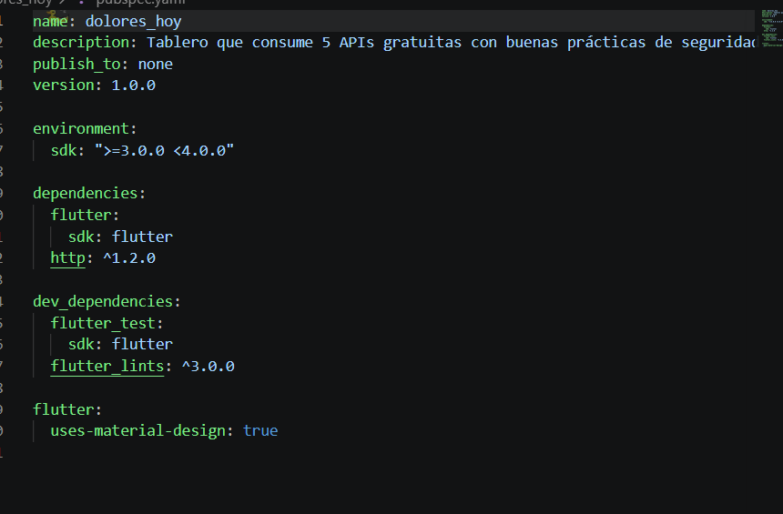 | 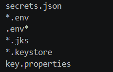 | 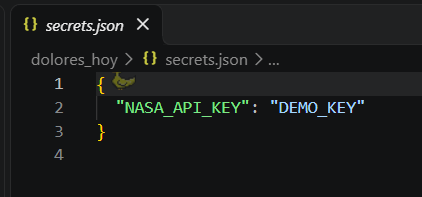 |

---

### Ronda 1 · Conociendo las 5 APIs

Cada API gratuita tiene límites y términos de uso que hay que respetar.

| # | API | Datos | Clave |
|:-:|-----|-------|:-----:|
| 1 | **Open-Meteo** | Clima actual de Dolores Hidalgo | No |
| 2 | **Frankfurter** | Tipo de cambio peso-dólar-euro | No |
| 3 | **Nager.Date** | Días festivos oficiales de México | No |
| 4 | **Wikipedia (es)** | Resumen de un tema escrito por el usuario | No |
| 5 | **NASA APOD** | Foto astronómica del día | **Sí** |


---

### Ronda 2 · Cimientos seguros: el cliente HTTP

`ClienteSeguro` es la **única puerta a internet**: las 5 APIs pasan por él, así que las reglas de seguridad se aplican una sola vez. Se probó con `MockClient`, sin internet y sin gastar cupo.

- Rechaza direcciones `http://` (solo `https`).
- Timeout y límite de tamaño de respuesta.
- Mensajes de error seguros (errores con nombre propio vs. mensaje genérico).
- Rechaza HTML cuando se espera JSON.
- Los logs ocultan la clave con `redactar()`.

| 🔴 Ayudas de prueba | 🔴 Pruebas del cliente |
|:-:|:-:|
| 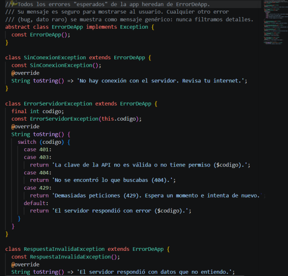 | 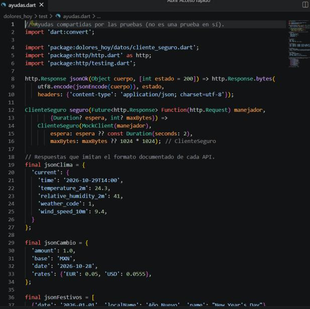 |

| 🟢 cliente_seguro.dart | ✅ flutter test |
|:-:|:-:|
| 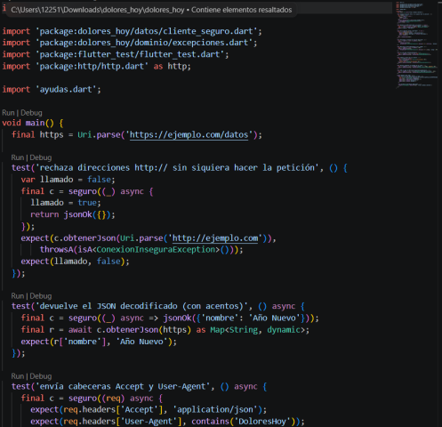 | 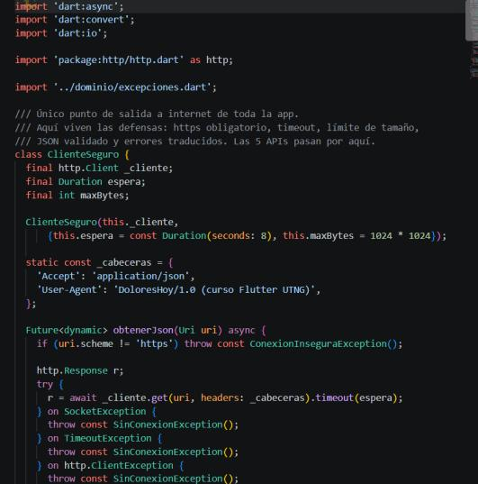 |

---

### Ronda 3 · API 1: Clima (Open-Meteo)

La más sencilla: sin clave y con respuesta limpia. Aquí se aprende el patrón que se repite en las demás: **modelo → servicio → pruebas**. Valida coordenadas fuera de rango y traduce los códigos de clima a texto.

| modelos.dart (Clima) | servicios.dart (Clima) | servicios.dart (Clima y cambio) |
|:-:|:-:|:-:|
| 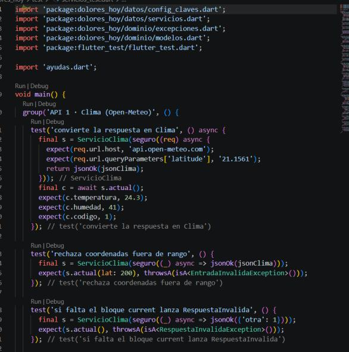 | 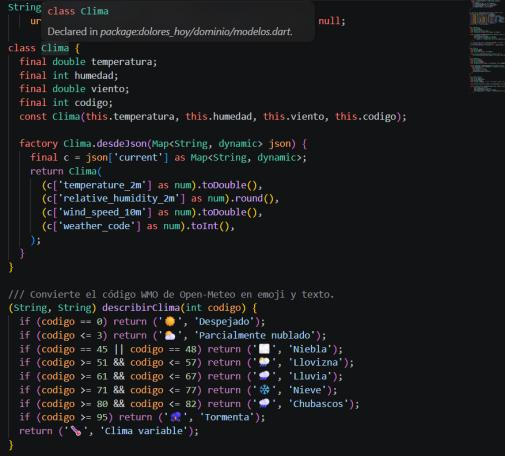 | 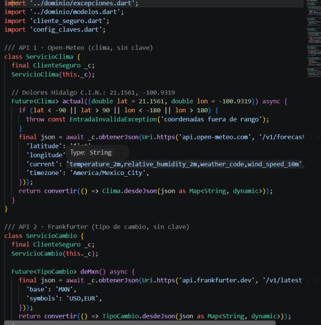 |

---

### Ronda 4 · API 2: Tipo de cambio (Frankfurter)

La API responde cuántas unidades de otra moneda se obtienen por 1 peso (`1 MXN = 0.05 USD`). Para saber cuántos pesos cuesta 1 dólar se **invierte la tasa**: `1 / 0.05 = 20`.

| 🔴 Pruebas del cambio | 🟢 modelos.dart (TipoCambio) | 🟢 servicios.dart (Cambio) |
|:-:|:-:|:-:|
| 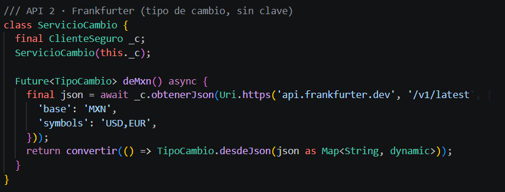 | 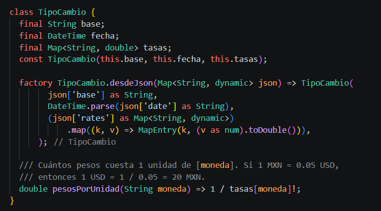 | 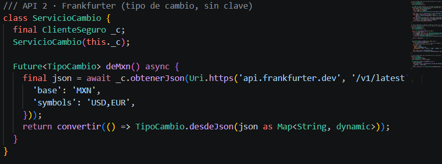 |

---

### Ronda 5 · API 3: Días festivos (Nager.Date)

Una prueba que depende de la fecha real caduca. La solución: **inyectar la fecha de hoy** como parámetro opcional (`hoy`), así las pruebas no dependen del calendario. También rechaza años fuera de rango.

| modelos.dart (Festivo) | servicios.dart (Festivos, parte 1) | servicios.dart (Festivos) |
|:-:|:-:|:-:|
| 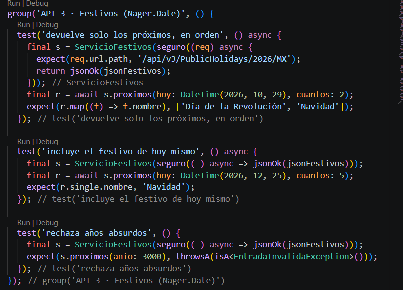 | 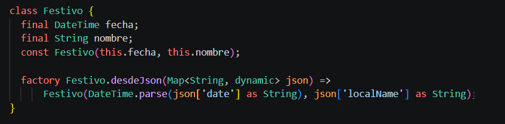 | 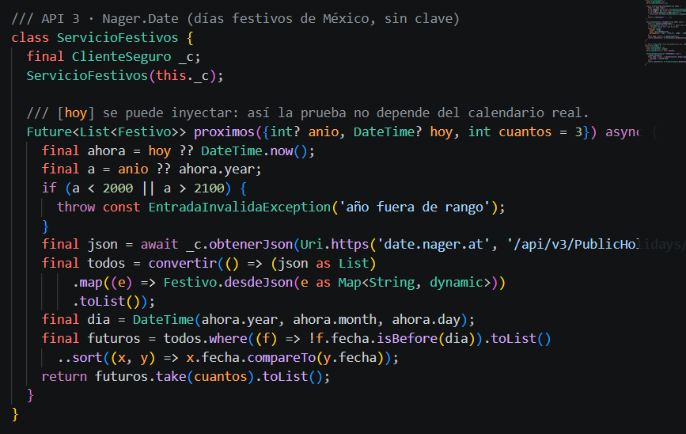 |

---

### Ronda 6 · API 4: Wikipedia y la entrada del usuario

Aquí el usuario escribe el tema, y ese texto viaja **dentro de la dirección**. Todo lo que escribe un usuario es potencialmente peligroso.

- Se valida: no vacío, máximo 80 caracteres, sin caracteres de control.
- Se previene la **inyección de ruta** (`../../admin`): el tema va como un solo segmento codificado con `pathSegments`, nunca con texto pegado.
- Se descartan miniaturas que no sean `https`.

| modelos.dart (Wikipedia) | servicios.dart (Wikipedia, parte 1) | servicios.dart (Wikipedia) |
|:-:|:-:|:-:|
| 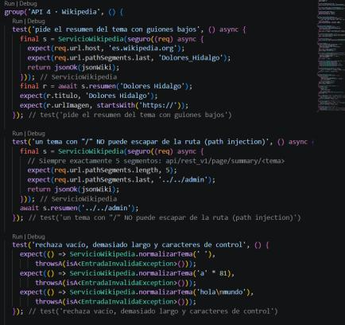 | 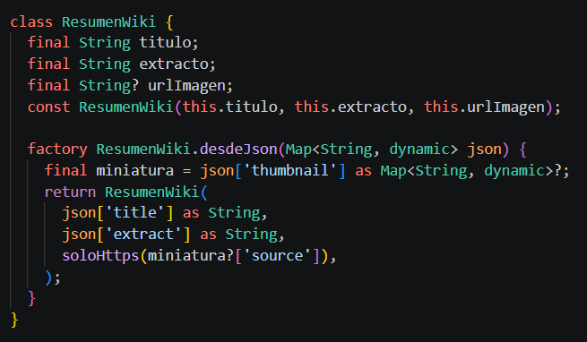 | 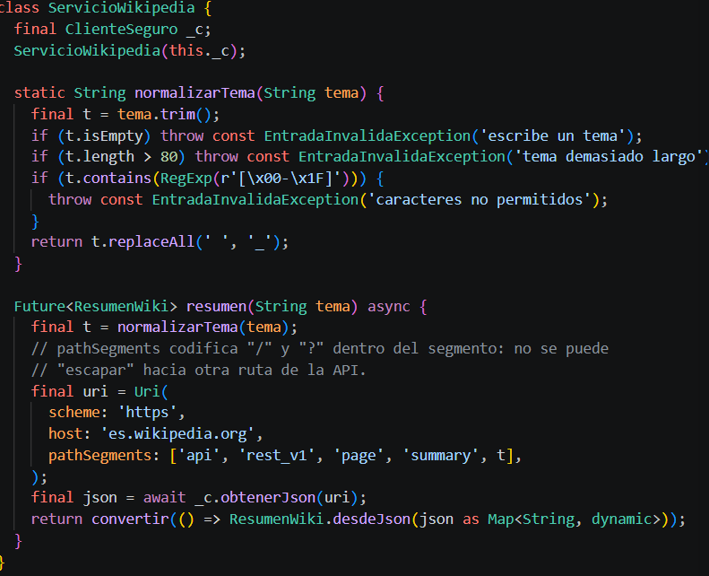 |

---

### Ronda 7 · API 5: NASA y el manejo seguro de claves

La única API que exige clave. Las claves se protegen en **capas**:

1. No escribirla en el código: entra al compilar con `--dart-define`.
2. No subirla a git: `.gitignore` desde el primer commit.
3. Mínimo privilegio: claves restringidas y fáciles de revocar.
4. Para claves valiosas: proxy en tu propio servidor.

```bash
flutter run --dart-define-from-file=secrets.json
```

`ConfigClaves` nunca imprime la clave completa, detecta `DEMO_KEY`, y sin clave válida ni siquiera hace la petición. Si la NASA publica un video, no hay imagen que mostrar; una URL `http://` se descarta.

| config_claves.dart | 🔴 Pruebas de la NASA | modelos.dart (NASA) |
|:-:|:-:|:-:|
| 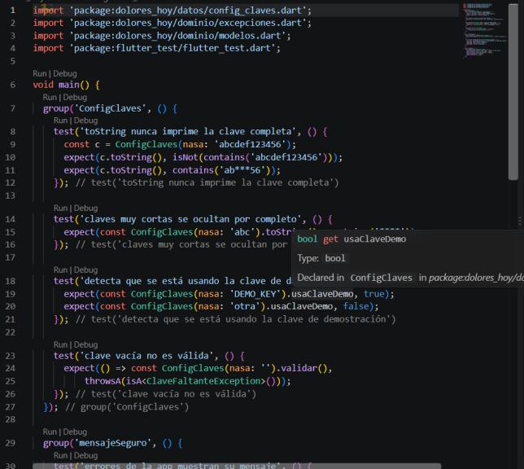 | 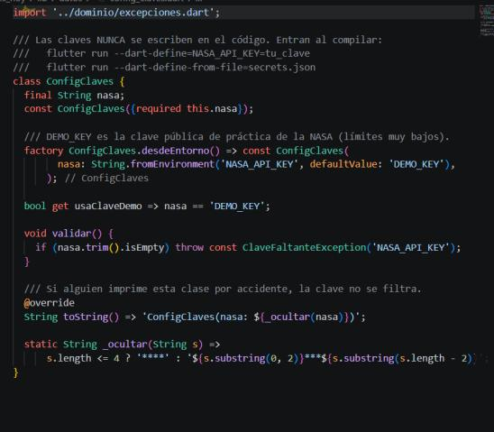 | 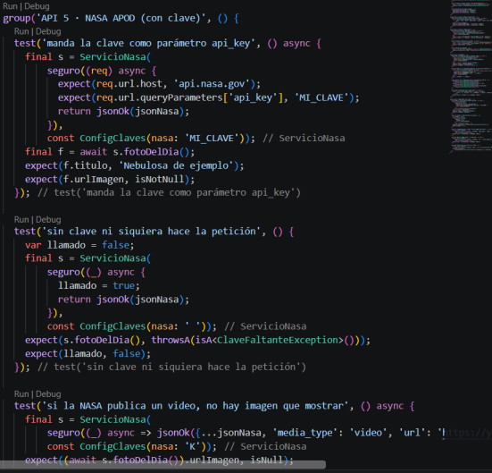 |

| servicios.dart (NASA, parte 1) | servicios.dart (NASA) |
|:-:|:-:|
| 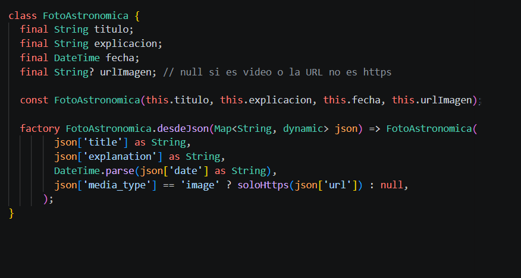 | 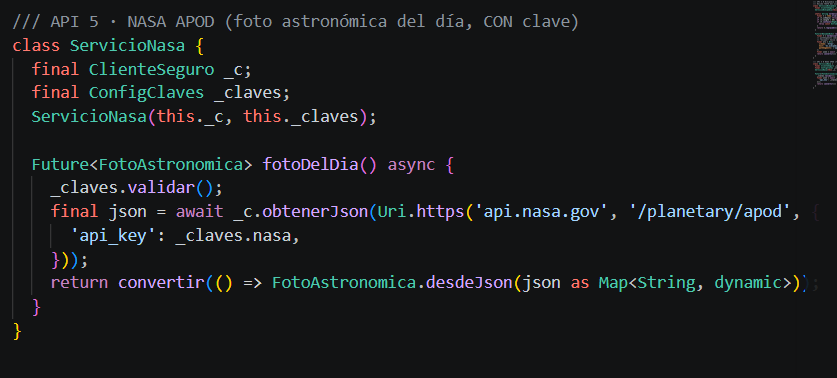 |

---

### Ronda 8 · El tablero: 5 APIs, cero dependencias entre ellas

Principio de la **puerta de emergencia**: si la NASA se cae, las otras cuatro siguen funcionando. Cada API tiene su propio estado (`Carga`: cargando, listo, error), el ViewModel atrapa los errores **uno por uno** y las 5 peticiones salen a la vez con `Future.wait`.

Pruebas: las 5 tarjetas cargan, si una falla las otras 4 siguen, sin internet la app no se cae, y `cargarTodo` anuncia el estado *cargando*.

| tablero_viewmodel.dart (parte 1) | tablero_viewmodel.dart (parte 2) |
|:-:|:-:|
| 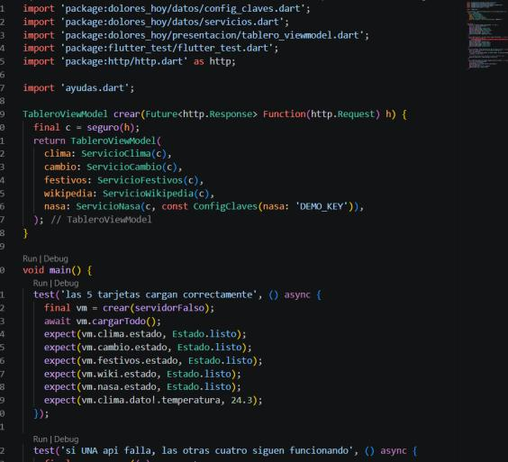 | 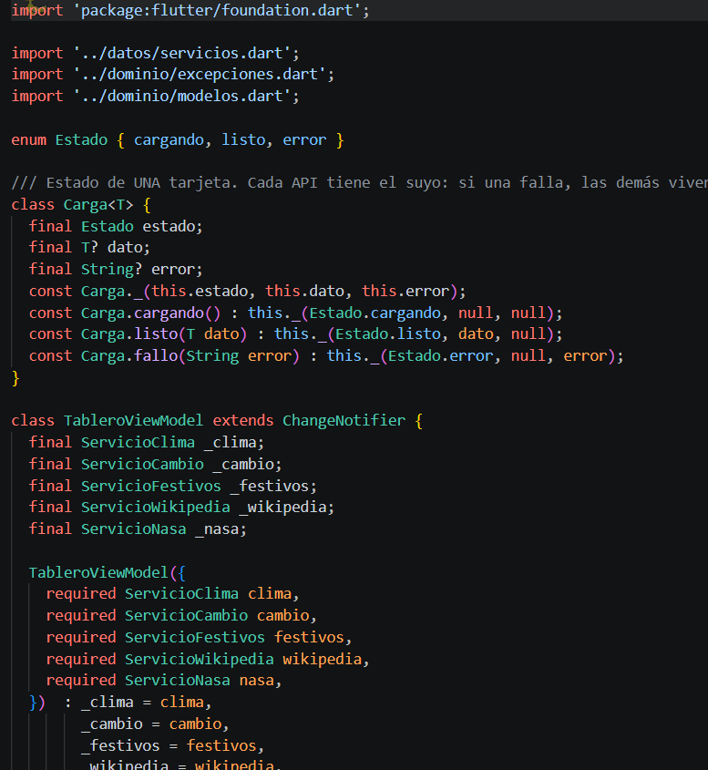 |

---

### Ronda 9 · La pantalla y la prueba final

La pantalla es "tonta" a propósito: solo dibuja lo que dice el ViewModel. `TarjetaCarga<T>` es un widget genérico que sirve para las 5 APIs (barra de carga, mensaje de error o contenido). `main.dart` es el único lugar donde se arma todo.

| pantalla_tablero.dart | main.dart |
|:-:|:-:|
| 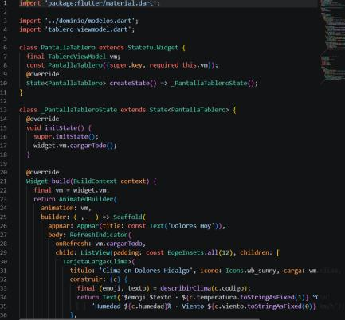 | 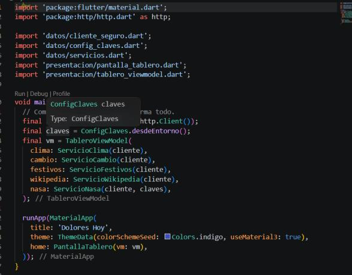 |

---

## ✅ Checklist de seguridad

## Evidencia de pruebas

La ejecución automatizada terminó correctamente. Resultado: **todas las pruebas aprobadas**.

### Ciclo TDD: rojo a verde

La captura roja reproduce de forma controlada el momento previo a implementar una regla; la verde corresponde a la suite final del repositorio.

| 🔴 Prueba que solicita código faltante | 🟢 Implementación terminada |
|---|---|
|  |  |

---

